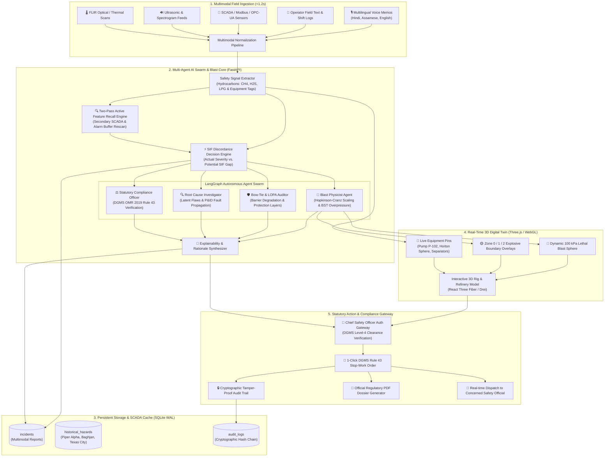

# SentinelSIF

<div align="center">


-003B57?style=for-the-badge&logo=sqlite&logoColor=white)


[](https://sentinel-sif.vercel.app)
[](https://sentinelsif-api.onrender.com)

**AI-Powered Serious Injury & Fatality (SIF) Precursor Prevention & Industrial Process Safety Decision Intelligence Platform**

*Bridge the SIF Paradox across offshore drilling rigs, refinery processing units, and tank farms: autonomous hydrocarbon leak detection, Hopkinson-Cranz thermodynamic blast physics modeling, real-time 3D WebGL digital twin hazard overlays, two-pass active feature recall, and 1-click DGMS OMR 2019 Rule 43 statutory isolation orders.*

[Key Features](#-key-features) • [Architecture](#-architecture) • [SIF Severity & Blast Risk Matrix](#-sif-severity--blast-risk-matrix) • [Technology Stack](#-technology-stack) • [Getting Started](#-getting-started) • [API Reference](#-api-reference) • [Statutory Directives & References](#-statutory-directives--scientific-references) • [License & Author](#-license--author)

</div>

---

## 🌟 Overview

**SentinelSIF** is an enterprise-grade industrial process safety decision intelligence platform engineered for **Oil India Limited (OIL)** and the **Ministry of Petroleum & Natural Gas** to address Smart India Hackathon problem statement **SIH26165**.

Unlike conventional EHS reporting systems that treat incident reports as static text documents, rely on Heinrich's Triangle assumptions, and leave near-miss notifications stalled in 72-hour administrative queues, **SentinelSIF** delivers an autonomous, real-time thermodynamic safety intelligence and statutory compliance platform. It connects frontline spoken memos, SCADA telemetry, first-principles blast thermodynamics ($W = \int P\,dV$), and interactive 3D WebGL digital twins directly to statutory enforcement actions under **DGMS Oil Mines Regulations (OMR) 2019 Rule 43**.

### The Problem: The SIF Paradox
In hazardous hydrocarbon environments, traditional EHS platforms operate on Heinrich's 300-29-1 safety pyramid, presuming that reducing minor slips, trips, and bruises proportionally prevents catastrophic disasters. **Historical inquiries (Piper Alpha, Deepwater Horizon, Texas City, Baghjan Well 5) prove this assumption fatal**:
* **80% of industrial fatalities** stem from precursor events with high latent energy, even when zero injuries occurred at the moment of the event.
* **72-Hour Bureaucracy Lag**: Field near-miss reports sit in paperwork or digital approval queues for days while fugitive hydrocarbon micro-leaks quietly escalate past Lower Explosive Limits (LEL).
* **Zero Thermodynamic Context**: Legacy software logs an unlatched door the exact same way as a vibrating high-pressure condensate pump seal bypass, leaving safety engineers blind to catastrophic vapor cloud explosions.

### The SentinelSIF Solution
SentinelSIF replaces retrospective paperwork with **autonomous real-time thermodynamic intervention**:
1. **Multimodal Field Ingestion (<1.2s)**: Ingests unstructured multilingual voice memos (Hindi, Assamese, English), field operator shift notes, and SCADA/Modbus sensor telemetry.
2. **SIF Discordance Decision Engine**: Calculates the mathematical divergence between Actual Severity and Potential SIF Consequence to expose high-energy precursor threats.
3. **First-Principles Chemical Blast Physics**: Executes Hopkinson-Cranz scaling ($Z = R / E^{1/3}$) and Baker-Strehlow-Tang (BST) vapor cloud explosion models to compute peak overpressure ($\Delta P$) and lethal shockwave radii.
4. **Interactive 3D WebGL Digital Twin**: Renders dynamic 100 kPa mortality spheres and ATEX Zone 0/1/2 explosive boundaries over platform machinery in real time.
5. **Two-Pass Active Feature Recall**: Scans secondary SCADA alarm buffers and maintenance histories to catch latent electrical and mechanical barrier failures missed in primary field reporting.
6. **Statutory DGMS Rule 43 Orders**: Dispatches legally binding, 1-click emergency stop-work and positive isolation orders directly to platform safety officials in under 90 seconds.

---

## 🏗️ Architecture



---

## ⚡ Key Features

- **🎙️ 5-Stage Multimodal Hazard Ingestion**: Ingests unstructured field text, multilingual spoken audio (Hindi, Assamese, English), FLIR thermal imaging, ultrasonic feeds, and SCADA sensor registers in under 1.2 seconds.
- **⚡ SIF Discordance Decision Engine**: Detects high-hazard "near misses" where immediate consequences were minor (Level 0/1), but latent thermodynamic energy could cause catastrophic multi-fatality events (Level 4/5).
- **🔬 Thermodynamic Blast Scaling Engine**:
  - First-principles implementation of the **Hopkinson-Cranz Scaling Law** ($Z = R / E^{1/3}$) and the **Baker-Strehlow-Tang (BST)** vapor cloud explosion model.
  - Computes instantaneous TNT equivalence, peak overpressure ($\Delta P$), and lethal shockwave blast radii.
- **🌐 Hardware-Accelerated 3D Digital Twin**: Rendered via Next.js 16, React Three Fiber, and WebGL. Operators can rotate, zoom, and inspect platform machinery (Pump P-102, Horton Spheres, Distillation Columns, Tank Farms) overlaid with dynamic 100 kPa mortality spheres and ATEX Zone 0/1/2 explosive boundaries.
- **🔊 Acoustic Spectrogram Diagnostics**: Embedded frequency-domain audio analyzer capable of identifying high-pressure gas hissing, valve cavitation, and ultrasonic leak signatures before mechanical failure.
- **🔍 Two-Pass Active Feature Recall**: AI Deep Recall scans secondary SCADA alarm buffers, PLC racks, and maintenance histories to detect latent safety features (such as jammed remote bleed actuators or clogged deluge nozzles) missed in primary reporting.
- **🤖 Autonomous Multi-Agent AI Swarm**: LangGraph-orchestrated agents cross-examine barrier degradations, calculate energy releases, and reconstruct P&ID fault trees without human fatigue.
- **🛑 DGMS OMR 2019 Rule 43 Action Gateway**: Generates legally binding, pre-filled statutory Stop-Work notices dispatched to the Concerned Safety Official in under 90 seconds.
- **🔐 Role-Based Statutory Access Control**: Strict DGMS Level-4 Chief Safety Officer authentication (Col. Rajiv Sharma, OIL-CSO-8042) ensuring legal accountability for isolation and shutdown actions.
- **📶 Air-Gapped & Offshore Edge Ready**: Built with containerized microservices and quantized local LLMs (Ollama / Llama 3) to operate 100% offline on drilling rigs without satellite internet dependency.

---

## 📊 SIF Severity & Blast Risk Matrix

SentinelSIF classifies every detected precursor against empirical blast physics, process thermodynamics, and statutory compliance triggers:

### 1. Equipment Node Precursor & Blast Assessment Table

| Equipment Node | Precursor Symptom | Hydrocarbon | Actual Severity | Potential SIF | Peak Overpressure ($\Delta P$) | 100 kPa Lethal Radius | Statutory Action Trigger |
| :--- | :--- | :--- | :---: | :---: | :---: | :---: | :--- |
| **Pump P-102** | Mechanical Seal Vibration / Micro-Leak | Condensate / C3-C4 | **Minor (Level 1)** | 🔴 **Fatal (Level 5)** | 142 kPa | 28.4 meters | DGMS Rule 43 Immediate Positive Isolation |
| **Horton Sphere H-1** | Relief Valve Chatter / Thermal Anomaly | Liquefied Petroleum Gas (LPG) | **Moderate (Level 2)** | 🔴 **Catastrophic (Level 5)** | 310 kPa | 64.2 meters | BLEVE Threat Protocol & Deluge Activation |
| **Separator V-201** | High-Pressure Flare Choke Bypass | Sour Methane ($CH_4 + H_2S$) | **Near-Miss (Level 0)** | 🔴 **Fatal (Level 5)** | 98 kPa | 19.8 meters | Toxic Gas & Flash Fire Exclusion Zone |
| **Compressor K-10** | Lube Oil Temperature Runaway | Natural Gas ($CH_4$) | **Minor (Level 1)** | 🟡 **Critical (Level 4)** | 62 kPa | 12.1 meters | Emergency Shutdown (ESD) Interlock |
| **Reboiler C-01** | Safety PLC Temperature Bypass Jumper | Distillate Hydrocarbon ($420^\circ C$) | **Minor (Level 1)** | 🔴 **Catastrophic (Level 5)** | 215 kPa | 41.6 meters | Cold Quench Solenoid Injection & Trip |

### 2. SIF Discordance Classification Taxonomy

| Level | Classification | Discordance Gap ($\Delta$) | Energy Signature | Operational Directive |
| :---: | :--- | :---: | :--- | :--- |
| **0** | **ROUTINE** | $0\% - 15\%$ | Zero hazardous energy release | Standard shift logging; nominal operations |
| **1** | **WATCH** | $16\% - 40\%$ | Low-pressure contained utility | Secondary barrier verification within 24 hours |
| **2** | **SIF PRECURSOR** | $41\% - 75\%$ | High latent hydrocarbon energy reserve | Immediate supervisor review; positive barrier check |
| **3** | **SERIOUS EVENT** | $76\% - 89\%$ | Active toxic/explosive loss of containment | Partial process unit trip; hot work permit revocation |
| **4** | **CRITICAL EVENT** | $90\% - 100\%$ | Unconfined vapor cloud or BLEVE threat | **DGMS Rule 43 Statutory Stop-Work Lockdown** |

---

## 🛠️ Technology Stack

| Layer | Technologies |
| :--- | :--- |
| **Frontend Framework** | **Next.js 16.3** (App Router), **React 19.2**, TypeScript 5 |
| **3D Engine & Digital Twin** | **Three.js 0.185**, **@react-three/fiber 9.7**, **@react-three/drei 10.7**, WebGL |
| **Styling & Visualization** | **Tailwind CSS 4.0**, Lucide React, Recharts |
| **Backend API & Runtime** | **Python 3.11+**, **FastAPI 1.0**, Uvicorn, Pydantic v2 |
| **AI & Agent Orchestration** | **LangGraph**, Quantized Local LLMs (Ollama / Llama 3), PyTorch |
| **Physics & Blast Modeling** | **NumPy**, **SciPy** (Hopkinson-Cranz Blast Equations & BST Models) |
| **Database & Persistence** | **SQLAlchemy**, SQLite with Native WAL Mode |
| **Statutory & Compliance Standards** | **DGMS OMR 2019 Rule 43**, **OISD-STD-105**, **CCPS LOPA**, **ISO 45001:2018** |

---

## 🚀 Getting Started

### Prerequisites
- **Node.js**: `>= 20.0.0`
- **Python**: `>= 3.10`
- **npm** or **pnpm**

### 1. Clone the Repository
```bash
git clone https://github.com/ChandraS0116/SentinelSIF.git
cd SentinelSIF
```

### 2. Backend Setup
```bash
cd backend

# Create and activate virtual environment
python -m venv venv

# On Windows:
.\venv\Scripts\activate
# On Linux/macOS:
# source venv/bin/activate

# Install Python dependencies
pip install -r requirements.txt

# Start FastAPI server
uvicorn main:app --reload --port 8000
```
*API will run at `http://localhost:8000` with interactive Swagger docs at `http://localhost:8000/docs`.*

### 3. Frontend Setup
In a new terminal window:
```bash
cd frontend

# Install dependencies
npm install

# Start Next.js development server
npm run dev
```
*Open [http://localhost:3000](http://localhost:3000) in your browser to launch the 3D Command Center.*

---

## 🔌 API Reference

### System & Authentication Endpoints

| Method | Endpoint | Description |
| :--- | :--- | :--- |
| `GET` | `/` | System health, client identity (`Oil India Limited`), and architectural status |
| `POST` | `/api/auth/login` | Authenticates Chief Safety Officer with DGMS Level-4 clearance validation |
| `GET` | `/api/auth/authorized-position` | Returns statutory officer clearance requirements and regulatory policies |
| `GET` | `/api/dashboard/overview` | Aggregated command center KPIs (active precursors, watch events, active zones) |
| `GET` | `/api/models/status` | Real-time health and version metadata for all active ML and rule engines |

### Incident Telemetry & Analysis Endpoints

| Method | Endpoint | Description |
| :--- | :--- | :--- |
| `POST` | `/api/incidents/` | Ingests a new multimodal incident or near-miss log into persistent storage |
| `GET` | `/api/incidents/` | Retrieves paginated platform incident telemetry records |
| `GET` | `/api/incidents/{incident_id}` | Retrieves full incident record and signal breakdowns by incident ID |
| `POST` | `/api/incidents/{incident_id}/analyze` | Runs the Multi-Agent Swarm, Blast Physics model, and DGMS Rule 43 evaluation |
| `POST` | `/api/incidents/recall-scan` | Executes Two-Pass Active Feature Recall across secondary SCADA and alarm logs |

### Historical Disaster Benchmarks Endpoints

| Method | Endpoint | Description |
| :--- | :--- | :--- |
| `GET` | `/api/hazards/historical` | Retrieves curated benchmark disasters (Piper Alpha, Baghjan, Texas City, Jaipur) |
| `GET` | `/api/hazards/stats` | Aggregated historical disaster statistics and statutory barrier failure metrics |

---

## 📜 Statutory Directives & Scientific References

1. **DGMS Oil Mines Regulations (OMR) 2019**: Rule 43 (*Emergency Powers & Statutory Stop-Work Authority*).
2. **OISD-GDN-169 & OISD-STD-105**: Work Permit Systems, Hazard Identification & Risk Assessment in Hydrocarbon Plants.
3. **The Campbell Institute (National Safety Council)**: *The SIF Paradox: Redefining Precursor Events* (2018).
4. **Center for Chemical Process Safety (CCPS / AIChE)**: *Layer of Protection Analysis (LOPA) & Bow-Tie Hazard Mitigation*.
5. **Hopkinson-Cranz Blast Scaling Formulation**: $Z = R / E^{1/3}$ for Hydrocarbon Vapor Cloud Explosions.
6. **Lord Cullen Public Inquiry**: *The Piper Alpha Disaster Report* (1988) — Condensate Pump Isolation Breakdown.
7. **Assam OIL High-Level Technical Inquiry**: *Baghjan Well #5 Blowout & Fire Investigation* (2020).

---

## 📄 License & Author

This project is licensed under the **MIT License** - see the [LICENSE](LICENSE) file for details.

Developed for the **Smart India Hackathon (SIH 2026)** under Problem Statement **SIH26165** for **Oil India Limited (OIL)** and the **Ministry of Petroleum & Natural Gas**.

**Sri Chandra Pappu**  
*Lead Developer & System Architect — SentinelSIF*  
[LinkedIn Profile](https://www.linkedin.com/in/chandrapappu1609) • [GitHub Profile](https://github.com/ChandraS0116)
